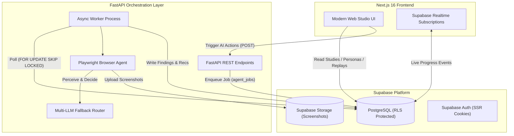
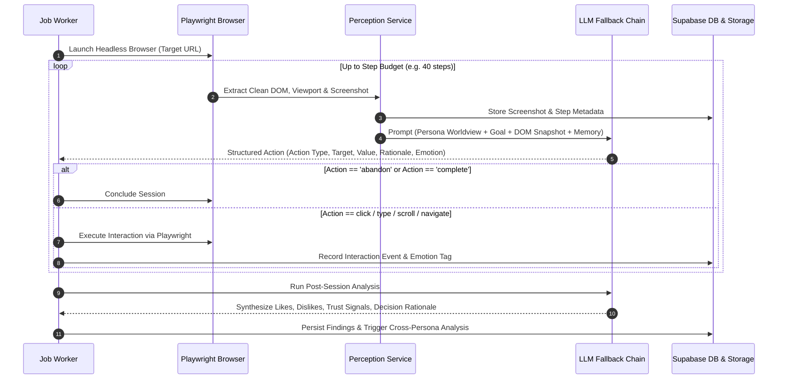

# UseWorldview

<div align="center">

<br />


### **AI-Powered Synthetic User Research Platform**

*Simulate realistic, diverse human personas interacting with your live web application autonomously via browser agents — delivering psychographic behavioral telemetry, step-by-step journey replays, and prioritized, evidence-backed UX recommendations.*

<br />

[](./LICENSE)
[](https://nextjs.org/)
[](https://react.dev/)
[](https://fastapi.tiangolo.com/)
[](https://www.python.org/)
[](https://supabase.com/)
[](https://playwright.dev/)
[](https://tailwindcss.com/)

<br />

[Explore Features](#-key-features) •
[Architecture](#-system-architecture) •
[Quick Start](#-quick-start) •
[API Reference](#-api-endpoints) •
[Frontend Guide](frontend/README.md) •
[Backend Guide](backend/README.md) •
[Contributing](CONTRIBUTING.md)

</div>

---

## 📖 Table of Contents

- [Overview](#-overview)
- [The Problem We Solve](#-the-problem-we-solve)
- [How UseWorldview Differs](#-how-useworldview-differs)
- [Key Features](#-key-features)
- [System Architecture](#-system-architecture)
  - [High-Level Data Flow](#high-level-data-flow)
  - [Cognitive Agent Perception-Action Loop](#cognitive-agent-perception-action-loop)
- [Repository Structure](#-repository-structure)
- [Data Model & Database Schema](#-data-model--database-schema)
- [API Endpoints](#-api-endpoints)
- [Quick Start](#-quick-start)
  - [Prerequisites](#prerequisites)
  - [1. Database Setup (Supabase)](#1-database-setup-supabase)
  - [2. Backend Setup (FastAPI & Playwright)](#2-backend-setup-fastapi--playwright)
  - [3. Frontend Setup (Next.js 16)](#3-frontend-setup-nextjs-16)
  - [4. Docker Compose Deployment](#4-docker-compose-deployment)
- [Environment Configuration](#-environment-configuration)
- [Development & Verification](#-development--verification)
- [License & Credits](#-license--credits)

---

## 🌟 Overview

**UseWorldview** is a synthetic user research platform engineered for modern product, design, growth, and engineering teams. Instead of waiting weeks and spending thousands of dollars recruiting small user panels, UseWorldview allows teams to test any live website or web application on demand.

Given a URL and a research objective, UseWorldview:
1. **Analyzes the product** and auto-detects nuanced target audience segments.
2. **Synthesizes realistic AI personas** complete with deep psychographic worldviews, cognitive biases, digital literacy levels, and situational motivations.
3. **Deploys autonomous browser agents** powered by headless Playwright and multimodal LLMs to navigate and interact with the application like real human visitors.
4. **Captures rich behavioral telemetry** — actions, hesitation, friction, rage clicks, confusion, and trust signals.
5. **Generates traceable, evidence-backed insights** with video-like journey replays and prioritized, five-part recommendations (`Problem → Evidence → Affected Users → Why It Matters → Suggested Fix`).

---

## 💔 The Problem We Solve

- **Traditional Usability Research is Slow & Costly**: Recruiting, scheduling, and moderating 5–10 real users takes 2–4 weeks and $3,000–$10,000+ per study.
- **Small Sample Sizes Miss Edge Cases**: Testing with only a handful of participants leaves significant blind spots across non-technical audiences, price-sensitive shoppers, or accessibility-dependent users.
- **Surface-Level "AI UX" Scanners**: Existing AI audit tools simply scrape a homepage URL, review marketing copy, and dump a generic checklist. They do not enter the application, click buttons, or experience real user friction.
- **Analytics Lack the "Why"**: Traditional product analytics (Mixpanel, PostHog, Hotjar) reveal *what* happened (e.g., 60% drop-off on `/pricing`), but cannot explain *why* users felt skeptical, confused, or unpersuaded.

---

## ⚡ How UseWorldview Differs

| Dimension | Traditional User Testing | Generic AI Reviewers | UseWorldview Synthetic Intelligence |
|---|---|---|---|
| **Turnaround Time** | 2–4 Weeks | ~60 Seconds | **3–8 Minutes per Study** |
| **Exploration Depth** | Human-guided / Scripted | Homepage screenshot only | **Multi-page autonomous app navigation** |
| **Persona Depth** | Small sample (5–10 people) | Generic "AI critic" prompt | **Full psychographic worldview engine** |
| **Skepticism & Realism** | Hawthorne effect (people are polite) | Overly agreeable & sycophantic | **Realistic hesitation, confusion, & abandonment** |
| **Explainability** | Notes & manual transcript tagging | Unverified LLM opinions | **Every finding linked to DOM events & screenshots** |
| **Recommendations** | Unstructured slide decks | Vague design advice | **Structured 5-part evidence-backed actions** |

```
Traditional AI:  URL  ──>  Homepage Scan  ──>  Generic UX Report
UseWorldview:    URL  ──>  Deep Ingestion ──>  Worldview Synthesis ──> Autonomous Exploration
                                                    │
                                                    ▼
                 5-Part Actionable Fixes  <──  Cross-Persona Synthesis  <──  Journey Replay & Telemetry
```

---

## 🧠 Key Features

### 1. Psychographic Worldview Engine
Personas in UseWorldview are not flat demographic tags. Each persona is synthesized with:
- **Demographics & Profile**: Age, profession, education, location, income bracket.
- **Psychographics**: Technical ability, digital literacy, risk tolerance, price sensitivity, patience level, and attention span.
- **Cognitive Context**: Current scenario, primary motivation, specific doubts, fears, and pre-existing expectations.
- **Customizable**: Edit, clone, tweak attributes, or generate new personas with custom criteria.

### 2. Autonomous Browser Exploration Agent
Our agents do not follow rigid hardcoded scripts. Running on headless Chromium via Playwright, each agent operates through a continuous cognitive loop:
- **Perceive**: Inspects the rendered DOM tree, strips noisy elements, identifies interactive targets (links, buttons, inputs), and captures viewport screenshots.
- **Decide**: Evaluates current observations against the persona's worldview and study goal to determine the next realistic action (click, scroll, type, navigate back, or abandon).
- **Act**: Executes human-like interactions with configurable delays and scrolls.
- **Observe**: Logs cognitive reactions, friction points, confusion, and feelings (`confused`, `interested`, `excited`, `frustrated`, `suspicious`, `confident`, `overwhelmed`).

### 3. Studio Journey Replay Scrubber
Inspect exactly what synthetic users experienced:
- Step-by-step visual scrubber with play/pause and variable playback speed (0.5x, 1x, 2x).
- Visual breadcrumbs and full DOM target selector paths.
- Inner-monologue thoughts and emotional sentiment tags displayed alongside each captured screenshot.

### 4. Cross-Persona Statistical Synthesis
Aggregates individual sessions into high-confidence quantitative and qualitative patterns:
- Value proposition clarity rate (e.g., *"8/10 users understood the core offering"*).
- Friction drop-off points (e.g., *"6/10 non-technical users abandoned at checkout"*).
- Segment-level behavioral discrepancy analysis (e.g., technical vs. non-technical contrast).

### 5. Five-Part Actionable Recommendation Engine
Every recommendation strictly adheres to our evidence-backed specification:
1. **Problem**: Clear statement of the usability hurdle or friction point.
2. **Evidence**: Specific URLs, DOM element selectors, and step timestamps where friction occurred.
3. **Affected Users**: List of personas and user segments impacted.
4. **Why It Matters**: Business and UX impact (conversion loss, bounce risk, brand erosion).
5. **Suggested Fix**: Concrete, actionable guidance for product, design, and engineering teams.

### 6. Resilient Multi-Provider LLM Fallback Chain
Zero downtime or rate-limit halts:
```
Groq (Llama 3.3 70B) ──> Google Gemini 2.0 Flash ──> OpenRouter ──> Anthropic Claude 3.5 Sonnet
```
If a provider encounters rate limits or errors, the request automatically falls back to the next provider, with all token costs tracked in `llm_usage_log`.

### 7. Autonomous Guardrails & Ethics
- **Domain Bounding**: Agents never wander off the designated domain or explore unauthorized external links.
- **Non-Destructive Actions**: Prevented from entering real credit cards or executing irreversible delete operations.
- **Robots.txt & Rate Limiting**: Full compliance with target site crawling policies.
- **Bounded Budgets**: Hard ceilings on max steps (default: 40) and wall-clock timeouts (default: 10 minutes) per session.

---

## 🏗 System Architecture

### High-Level Data Flow

UseWorldview follows a modern **"Thin API, Fat Supabase"** architecture:
- **Frontend reads directly from Supabase** using PostgreSQL Row-Level Security (RLS) for studies, personas, sessions, telemetry, and recommendations.
- **Frontend writes non-AI updates directly to Supabase** (e.g., editing persona attributes, updating themes).
- **Backend API owns only AI & orchestration jobs** (site analysis, persona generation, running browser sessions, and cross-persona synthesis).
- **Async Workers** process jobs from a PostgreSQL `agent_jobs` queue using `FOR UPDATE SKIP LOCKED`, writing artifacts directly into Supabase.



### Cognitive Agent Perception-Action Loop



---

## 📁 Repository Structure

```
.
├── backend/                       # Python FastAPI + Playwright backend service
│   ├── app/
│   │   ├── api/                   # REST endpoints & dependency injection
│   │   │   ├── routes/studies.py  # 6 core AI orchestration endpoints
│   │   │   └── deps.py            # JWT verification & user context
│   │   ├── core/                  # Infrastructure & configuration
│   │   │   ├── config.py          # Pydantic v2 settings
│   │   │   ├── llm_client.py      # Resilient multi-provider LLM router
│   │   │   ├── security.py        # Supabase JWT validation
│   │   │   └── supabase_client.py # Service-role client factory
│   │   ├── db/migrations/         # SQL DDL & Row-Level Security policies
│   │   │   ├── 0001_init.sql      # Core schema, RLS, functions & triggers
│   │   │   └── 0002_add_overlay.sql
│   │   ├── jobs/                  # Background worker & job queue
│   │   │   ├── queue.py           # Postgres SKIP LOCKED job claimer
│   │   │   ├── worker.py          # Unified worker loop
│   │   │   └── job_types.py       # Job definitions
│   │   ├── models/                # Pydantic validation schemas
│   │   └── services/              # Autonomous agent & analysis engines
│   │       ├── agent_session/     # Browser driver, perceive, decide, act
│   │       ├── site_analysis.py   # Initial URL crawl & metadata scraper
│   │       ├── audience_detection.py
│   │       ├── persona_generation.py
│   │       ├── post_session_analysis.py
│   │       ├── cross_persona_analysis.py
│   │       └── recommendations_engine.py
│   ├── Dockerfile                 # API production container
│   ├── Dockerfile.worker          # Standalone background worker container
│   ├── docker-compose.yml         # Unified local container stack
│   ├── requirements.txt           # Python dependencies
│   └── README.md                  # Comprehensive Backend Documentation
│
├── frontend/                      # Next.js 16 (App Router) Web Studio
│   ├── app/                       # App Router pages and layouts
│   │   ├── (marketing)/           # Landing page with interactive cognitive demo
│   │   ├── (auth)/                # Sign-in, sign-up, and OAuth callback
│   │   ├── (app)/                 # Protected application dashboard
│   │   │   ├── dashboard/         # Active & completed studies overview
│   │   │   ├── studies/new/       # 5-stage study creation wizard
│   │   │   ├── studies/[studyId]/ # Study results, personas, replays & recs
│   │   │   └── settings/          # Profile & theme preferences
│   │   ├── globals.css            # Tailwind CSS v4 design tokens
│   │   └── providers.tsx          # TanStack Query & ThemeProvider
│   ├── lib/                       # Utilities and integrations
│   │   ├── supabase/              # SSR cookie & browser client factories
│   │   ├── api.ts                 # Type-safe client for backend endpoints
│   │   └── types.ts               # Complete TypeScript database types
│   ├── package.json               # Frontend dependencies
│   └── README.md                  # Comprehensive Frontend Documentation
│
├── DESIGN.md                      # Design System & Visual Specification
├── CONTRIBUTING.md                # Contribution Guidelines
├── LICENSE                        # MIT License
└── README.md                      # Project Root README
```

---

## 🗄 Data Model & Database Schema

The platform runs on PostgreSQL via Supabase with strict Row-Level Security (RLS) enabled on all customer-facing tables:

| Table | Purpose | Access Policy |
|---|---|---|
| `profiles` | User profile, notification settings, theme preference | Users read/update own record |
| `studies` | Target URL, research objectives, study status | Users manage own studies |
| `audience_segments` | Detected and customized audience groups per study | Inherited via study owner |
| `personas` | Full psychographic worldview profiles | Inherited via study owner |
| `agent_sessions` | Execution state of an individual persona browsing session | Inherited via study owner |
| `interaction_events` | Granular event telemetry (click, scroll, type, screen coordinates) | Inherited via study owner |
| `findings` | Persona-specific likes, dislikes, feelings, and friction points | Inherited via study owner |
| `decision_explanations`| Detailed narrative explaining why a persona completed or abandoned | Inherited via study owner |
| `cross_persona_insights`| Statistical pattern statements aggregated across personas | Inherited via study owner |
| `recommendations` | Prioritized 5-part actionable UX recommendations | Inherited via study owner |
| `agent_jobs` | Background task queue claimed using `FOR UPDATE SKIP LOCKED` | Service-role only |
| `llm_usage_log` | Detailed token consumption and latency auditing per provider | Service-role only |

---

## 🔌 API Endpoints

The FastAPI backend exposes 8 REST endpoints for AI orchestration:

| Method | Path | Authentication | Description |
|---|---|---|---|
| `GET` | `/api/health` | Public | System health check and service status |
| `POST` | `/api/studies` | Bearer JWT | Create study & initiate site ingestion |
| `POST` | `/api/studies/{id}/personas/generate` | Bearer JWT | Auto-generate psychographic AI personas |
| `POST` | `/api/personas/{id}/regenerate` | Bearer JWT | Regenerate a single persona's worldview |
| `POST` | `/api/studies/{id}/deploy` | Bearer JWT | Launch autonomous browser agent sessions |
| `POST` | `/api/studies/{id}/cancel` | Bearer JWT | Abort in-flight agent sessions and jobs |
| `POST` | `/api/studies/{id}/retry-failed-sessions` | Bearer JWT | Re-run failed agent sessions |
| `DELETE` | `/api/studies/{id}/purge-storage` | Bearer JWT | Purge session screenshot assets from storage |

*Note: All read operations (querying studies, personas, replays, findings, and recommendations) are performed directly by the Next.js client against Supabase via RLS.*

---

## 🚀 Quick Start

### Prerequisites
- **Node.js**: `v20.x` or later (tested with v22+)
- **Python**: `3.11` or `3.12`
- **Docker & Docker Compose** (optional, for containerized run)
- **Supabase Account**: Free or Pro tier project
- **At least one LLM API Key**: Groq, Google Gemini, OpenRouter, or Anthropic Claude

---

### 1. Database Setup (Supabase)

1. Open your Supabase project dashboard and navigate to the **SQL Editor**.
2. Run the core migration script:
   [`backend/db/migrations/0001_init.sql`](backend/db/migrations/0001_init.sql)
3. *(Optional)* Apply additional migrations if present:
   [`backend/db/migrations/0002_add_overlay_event_type.sql`](backend/db/migrations/0002_add_overlay_event_type.sql)
4. Verify that the `screenshots` storage bucket is set up (the backend auto-provisions this on first boot if missing).

---

### 2. Backend Setup (FastAPI & Playwright)

```bash
cd backend

# Create and activate Python virtual environment
python3 -m venv venv
source venv/bin/activate

# Install dependencies
pip install -r requirements.txt

# Install Playwright browser binaries
playwright install chromium

# Configure environment variables
cp .env.example .env
# Edit .env with your Supabase credentials and LLM API keys

# Start API and Worker in unified mode
uvicorn app.main:app --reload --port 8000
```

Verify backend health:
```bash
curl http://localhost:8000/api/health
# {"status":"healthy","version":"1.0.0"}
```

---

### 3. Frontend Setup (Next.js 16)

```bash
cd frontend

# Install Node dependencies
npm install

# Configure environment variables
cp .env.example .env.local
# Set NEXT_PUBLIC_SUPABASE_URL, NEXT_PUBLIC_SUPABASE_ANON_KEY, and NEXT_PUBLIC_BACKEND_API_URL

# Start Next.js development server
npm run dev
```

Open [http://localhost:3000](http://localhost:3000) in your browser.

---

### 4. Docker Compose Deployment

To run the unified backend container locally with Docker:

```bash
cd backend
docker compose up --build
```

---

## ⚙️ Environment Configuration

### Backend (`backend/.env`)

```ini
# Supabase Configuration
SUPABASE_URL=https://your-project.supabase.co
SUPABASE_SERVICE_ROLE_KEY=your-supabase-service-role-key
SUPABASE_JWT_SECRET=your-supabase-jwt-secret

# LLM Providers (at least one required)
GROQ_API_KEY=gsk_...
GEMINI_API_KEY=AIza...
OPENROUTER_API_KEY=sk-or-...
ANTHROPIC_API_KEY=sk-ant-...

# Fallback Preference Order
LLM_FALLBACK_ORDER=groq,gemini,openrouter,claude

# Agent Exploration Limits
PLAYWRIGHT_HEADLESS=true
MAX_STEP_BUDGET_DEFAULT=40
MAX_PAGES_DEFAULT=5
SESSION_WALL_CLOCK_TIMEOUT_SECONDS=600

# Worker Settings
RUN_MODE=unified
WORKER_CONCURRENCY=2
WORKER_POLL_INTERVAL_SECONDS=2
```

### Frontend (`frontend/.env.local`)

```ini
NEXT_PUBLIC_SUPABASE_URL=https://your-project.supabase.co
NEXT_PUBLIC_SUPABASE_ANON_KEY=your-supabase-anon-key
NEXT_PUBLIC_BACKEND_API_URL=http://localhost:8000
```

---

## 🧪 Development & Verification

### Running Backend Unit Tests
```bash
cd backend
pytest -v
```

### Frontend Code Quality
```bash
cd frontend
npm run lint
npm run build
```

---

## 📄 License & Credits

This project is licensed under the **MIT License** — see the [LICENSE](LICENSE) file for details.

Developed with ❤️ by **Abhinav Sharma** and the **UseWorldview** team.
For questions or feedback, open an issue or reach out via [GitHub](https://github.com/useworldview).
