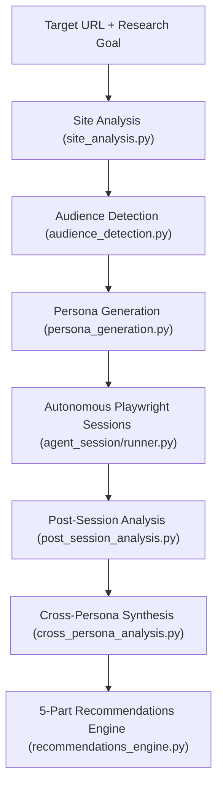

# UseWorldview — Backend Orchestration Service

<div align="center">

<br />

### **AI-Powered Synthetic User Research Orchestration Engine**

*FastAPI orchestration layer driving headless Playwright browser agents, psychographic persona simulation, multi-provider LLM routing, and structured UX insight generation.*

<br />

[](https://fastapi.tiangolo.com/)
[](https://www.python.org/)
[](https://playwright.dev/)
[](https://supabase.com/)
[](https://github.com/useworldview/useworldview)

<br />

</div>

---

## 📖 Table of Contents

- [Overview](#-overview)
- [Architectural Philosophy](#-architectural-philosophy)
  - [Thin API, Fat Supabase](#thin-api-fat-supabase)
  - [Postgres-Backed Job Queue (`SKIP LOCKED`)](#postgres-backed-job-queue-skip-locked)
- [The Autonomous Browser Agent Engine](#-the-autonomous-browser-agent-engine)
  - [The Cognitive Loop](#the-cognitive-loop)
  - [Agent Safety & Guardrails](#agent-safety--guardrails)
- [Multi-Provider LLM Fallback Router](#-multi-provider-llm-fallback-router)
- [The Orchestration Pipeline](#-the-orchestration-pipeline)
- [Repository Structure](#-repository-structure)
- [Database Schema & Migrations](#-database-schema--migrations)
- [API Reference](#-api-reference)
- [Run Modes](#-run-modes)
- [Local Development Setup](#-local-development-setup)
- [Docker Deployment](#-docker-deployment)
- [Environment Variables](#-environment-variables)
- [Testing & Quality Assurance](#-testing--quality-assurance)
- [License](#-license)

---

## 🌟 Overview

The **UseWorldview Backend** is the core autonomous intelligence and execution engine of the platform. Given a target website URL and a customer research goal, this service coordinates:
1. **Target Site Analysis**: Ingests, parses, and assesses target landing pages.
2. **Audience Detection**: Infers plausible visitor archetypes based on site messaging and positioning.
3. **Psychographic Persona Synthesis**: Generates believable individuals with coherent goals, anxieties, digital literacy, and price sensitivities.
4. **Autonomous Browsing Sessions**: Directs headless Playwright Chromium agents using computer vision and DOM perception.
5. **Post-Session Telemetry Processing**: Extracts likes, dislikes, emotional sentiment, and decision explanations.
6. **Cross-Persona Synthesis & Recommendations**: Generates 5-part actionable UX recommendations.

---

## 🏛 Architectural Philosophy

### Thin API, Fat Supabase
To maximize simplicity and eliminate unnecessary boilerplate:
- **Direct Client Reads**: The frontend reads all research data (studies, personas, sessions, events, findings, recommendations) directly from Supabase via PostgreSQL Row-Level Security (RLS).
- **Direct Client Writes**: Non-compute edits (renaming a persona, tweaking a research goal, marking recommendations) happen directly between the frontend and Supabase.
- **Dedicated AI Engine**: This backend service only exposes endpoints for tasks requiring LLM calls, Playwright browser execution, or background processing.

### Postgres-Backed Job Queue (`SKIP LOCKED`)
Instead of operating complex third-party message brokers like Redis or Celery in V1:
- Tasks are inserted into the `agent_jobs` PostgreSQL table with status `pending`.
- Polling workers atomically claim jobs using:
  ```sql
  SELECT * FROM agent_jobs
  WHERE status = 'pending'
  ORDER BY created_at ASC
  LIMIT 1
  FOR UPDATE SKIP LOCKED;
  ```
- This ensures zero extra infrastructure overhead, bulletproof atomic locks, and effortless horizontal worker scalability.

---

## 🤖 The Autonomous Browser Agent Engine

Located in `app/services/agent_session/`, the agent engine runs autonomous web interactions that reflect real human browsing behavior.

```
       ┌────────────────────────────────────────────────────────┐
       │               Autonomous Cognitive Loop                │
       └────────────────────────────────────────────────────────┘
                                    │
                                    ▼
       ┌────────────────────────────────────────────────────────┐
       │ 1. PERCEIVE (perceive.py)                              │
       │    - Clean rendered DOM tree                           │
       │    - Extract clickable & interactive targets           │
       │    - Capture high-resolution screenshot                │
       └────────────────────────────────────────────────────────┘
                                    │
                                    ▼
       ┌────────────────────────────────────────────────────────┐
       │ 2. DECIDE (decide.py)                                  │
       │    - Persona psychographic worldview                   │
       │    - Active study research objective                   │
       │    - Short-term session memory                         │
       │    - LLM returns structured action & emotion           │
       └────────────────────────────────────────────────────────┘
                                    │
                                    ▼
       ┌────────────────────────────────────────────────────────┐
       │ 3. ACT (act.py)                                        │
       │    - Playwright Chromium interaction                   │
       │    - Natural mouse clicks, scrolls, form inputs        │
       └────────────────────────────────────────────────────────┘
                                    │
                                    ▼
       ┌────────────────────────────────────────────────────────┐
       │ 4. OBSERVE (runner.py)                                 │
       │    - Log event telemetry & coordinates                 │
       │    - Upload screenshot to Supabase Storage             │
       │    - Check termination condition or repeat             │
       └────────────────────────────────────────────────────────┘
```

### Key Modules:
- **`browser_driver.py`**: Headless Chromium lifecycle management via Playwright. Configured with `playwright-stealth` to bypass automated bot heuristics, handle cookie banners, and snapshot viewports.
- **`perceive.py`**: Filters noise (scripts, styles, hidden SVGs), assigns deterministic numeric selector IDs to interactable DOM nodes, and prepares clean vision contexts.
- **`decide.py`**: Prompts the multimodal LLM with the persona's worldview (e.g. *"You are Elena, a skeptical 42-year-old CFO who hates hidden fees"*), forcing realistic friction or abandonment rather than sycophantic praise.
- **`act.py`**: Dispatches humanized actions into Playwright (`click`, `fill`, `scroll`, `navigate_back`, `wait`, or `finish`).
- **`guardrails.py`**: Enforces strict safety policies:
  - Domain isolation (agents cannot leave target site origin).
  - Blocklist preventing real payment gateway inputs or destructive form submissions.
  - Step budget ceilings (`MAX_STEP_BUDGET_DEFAULT = 40`) and hard timeouts (`600s`).

---

## ⚡ Multi-Provider LLM Fallback Router

The LLM abstraction in `app/core/llm_client.py` provides resilient routing across multiple AI providers:

```
Groq (Llama 3.3 70B) ──> Google Gemini 2.0 Flash ──> OpenRouter ──> Anthropic Claude 3.5 Sonnet
```

- **Resilience**: If a provider triggers rate limits (`429`), timeouts, or quota errors, the client immediately switches to the next configured fallback provider.
- **Cost Auditing**: Every single LLM invocation records input tokens, output tokens, provider used, latency, and estimated cost into the `llm_usage_log` table.

---

## 🔄 The Orchestration Pipeline



1. **`site_analysis.py`**: Performs initial crawl, verifies `robots.txt`, extracts page title, meta tags, and hero copy.
2. **`audience_detection.py`**: Infers 3–5 candidate audience segments tailored to the product category.
3. **`persona_generation.py`**: Generates full psychographic profiles with 15+ dimensions (goals, motivations, fears, patience, digital literacy, risk tolerance).
4. **`post_session_analysis.py`**: Reviews the session event log and extracts evidence-linked likes, dislikes, trust signals, and decision rationales.
5. **`cross_persona_analysis.py`**: Analyzes all persona sessions in a study to identify consensus and divergence (e.g. *"7/10 users hesitated on pricing"*).
6. **`recommendations_engine.py`**: Transforms aggregate friction patterns into structured, prioritized recommendations.

---

## 📂 Repository Structure

```
backend/
├── app/
│   ├── api/
│   │   ├── deps.py                    # JWT validation & user authentication
│   │   └── routes/
│   │       └── studies.py             # 8 REST endpoints
│   ├── core/
│   │   ├── config.py                  # Pydantic v2 application settings
│   │   ├── llm_client.py              # Multi-provider LLM fallback router
│   │   ├── security.py                # Supabase JWT token verification
│   │   └── supabase_client.py         # Service-role Supabase client
│   ├── db/
│   │   └── migrations/
│   │       ├── 0001_init.sql          # Primary database schema & RLS
│   │       └── 0002_add_overlay.sql   # Overlay interaction migration
│   ├── jobs/
│   │   ├── job_types.py               # Job payload definitions
│   │   ├── queue.py                   # PostgreSQL SKIP LOCKED queue
│   │   └── worker.py                  # Polling job worker daemon
│   ├── models/
│   │   └── schemas.py                 # Pydantic request & response models
│   ├── services/
│   │   ├── agent_session/             # Autonomous Playwright browsing engine
│   │   ├── audience_detection.py      # Target segment inference
│   │   ├── cross_persona_analysis.py  # Cross-session pattern synthesis
│   │   ├── persona_generation.py      # Psychographic worldview generator
│   │   ├── post_session_analysis.py   # Post-session findings extraction
│   │   ├── recommendations_engine.py  # 5-part UX recommendation generator
│   │   └── site_analysis.py           # Target site crawling & metadata
│   └── main.py                        # FastAPI application setup & lifecycle
├── db/migrations/                     # Symlink/copy of DB migrations
├── tests/                             # Pytest test suite
├── Dockerfile                         # Production API container image
├── Dockerfile.worker                  # Dedicated background worker container
├── docker-compose.yml                 # Local multi-service orchestration
├── requirements.txt                   # Pinned Python dependencies
└── worker_entrypoint.py               # Standalone worker script
```

---

## 🗄 Database Schema & Migrations

Database migrations are located in [`db/migrations/0001_init.sql`](db/migrations/0001_init.sql). Run this file in your Supabase SQL Editor.

### Key Tables Managed:
- `profiles`: User preferences and metadata.
- `studies`: Studies, target URLs, research goals, and processing status.
- `audience_segments`: Target audience segments.
- `personas`: Detailed psychographic attributes and worldview context.
- `agent_sessions`: Individual persona session status and duration.
- `interaction_events`: Step-by-step telemetry (action, target selector, URL, timestamp, screenshot).
- `findings`: Likes, dislikes, emotional tags, and friction points.
- `decision_explanations`: Why a persona completed or abandoned.
- `cross_persona_insights`: Cross-session pattern statements.
- `recommendations`: 5-part actionable UX recommendations.
- `agent_jobs`: Background job queue.
- `llm_usage_log`: Token usage, provider auditing, and cost analytics.

---

## 🔌 API Reference

### Health Check
```http
GET /api/health
```
**Response:**
```json
{
  "status": "healthy",
  "version": "1.0.0"
}
```

---

### Create Study & Ingest Site
```http
POST /api/studies
Authorization: Bearer <SUPABASE_JWT>
Content-Type: application/json
```
**Body:**
```json
{
  "target_url": "https://example.com",
  "research_goals": [
    { "type": "template", "value": "overall product experience" }
  ],
  "confirmed_authorized": true
}
```

---

### Generate Personas
```http
POST /api/studies/{study_id}/personas/generate
Authorization: Bearer <SUPABASE_JWT>
```

---

### Regenerate Single Persona
```http
POST /api/personas/{persona_id}/regenerate
Authorization: Bearer <SUPABASE_JWT>
```

---

### Deploy Agents into Target Site
```http
POST /api/studies/{study_id}/deploy
Authorization: Bearer <SUPABASE_JWT>
```

---

### Cancel Study Run
```http
POST /api/studies/{study_id}/cancel
Authorization: Bearer <SUPABASE_JWT>
```

---

### Retry Failed Sessions
```http
POST /api/studies/{study_id}/retry-failed-sessions
Authorization: Bearer <SUPABASE_JWT>
```

---

### Purge Storage
```http
DELETE /api/studies/{study_id}/purge-storage
Authorization: Bearer <SUPABASE_JWT>
```

---

## ⚙️ Run Modes

The service supports multiple operational modes configured via `RUN_MODE`:

| `RUN_MODE` | Description | Typical Use Case |
|---|---|---|
| `unified` *(Default)* | Runs both the FastAPI REST server and the background polling worker within a single process. | Local development, single-container Google Cloud Run / Railway. |
| `api_only` | Runs only the FastAPI web server. | High-traffic deployments where workers scale independently. |
| `worker_only`| Runs only the polling worker daemon. | Dedicated compute nodes running Playwright browser agents. |
| `webhook` | Listens for Supabase Database Webhooks instead of polling. | Event-driven serverless environments. |

---

## 🚀 Local Development Setup

### 1. Prerequisites
- Python 3.11+
- Playwright Chromium binaries
- Active Supabase project

### 2. Setup Virtual Environment
```bash
cd backend
python3 -m venv venv
source venv/bin/activate
pip install -r requirements.txt
playwright install chromium
```

### 3. Configure Environment
```bash
cp .env.example .env
# Fill in your SUPABASE_URL, SUPABASE_SERVICE_ROLE_KEY, SUPABASE_JWT_SECRET
# Provide at least one LLM key (GROQ_API_KEY, GEMINI_API_KEY, OPENROUTER_API_KEY, ANTHROPIC_API_KEY)
```

### 4. Run Server
```bash
# Unified mode (API + worker)
uvicorn app.main:app --reload --port 8000
```

---

## 🐳 Docker Deployment

Build and run using Docker Compose:

```bash
cd backend
docker compose up --build
```

To run a standalone background worker container:
```bash
docker build -f Dockerfile.worker -t useworldview-worker .
docker run --env-file .env useworldview-worker
```

---

## ⚙️ Environment Variables

| Variable | Required | Default | Description |
|---|---|---|---|
| `SUPABASE_URL` | Yes | - | URL of your Supabase instance |
| `SUPABASE_SERVICE_ROLE_KEY` | Yes | - | Service role secret key (bypasses RLS) |
| `SUPABASE_JWT_SECRET` | Yes | - | Secret for decoding and verifying user JWTs |
| `GROQ_API_KEY` | Optional* | - | Groq API key (Llama 3.3 70B) |
| `GEMINI_API_KEY` | Optional* | - | Google Gemini API key |
| `OPENROUTER_API_KEY` | Optional* | - | OpenRouter API key |
| `ANTHROPIC_API_KEY` | Optional* | - | Anthropic Claude API key |
| `LLM_FALLBACK_ORDER` | No | `groq,gemini,openrouter,claude` | Fallback priority list |
| `RUN_MODE` | No | `unified` | `unified`, `api_only`, `worker_only` |
| `PLAYWRIGHT_HEADLESS` | No | `true` | Run Chromium in headless mode |
| `MAX_STEP_BUDGET_DEFAULT` | No | `40` | Maximum navigation steps per persona |
| `MAX_PAGES_DEFAULT` | No | `5` | Maximum unique URLs explored per session |
| `SESSION_WALL_CLOCK_TIMEOUT_SECONDS` | No | `600` | Max duration per browser session |
| `WORKER_POLL_INTERVAL_SECONDS` | No | `2` | Interval between worker job polls |
| `WORKER_CONCURRENCY` | No | `2` | Parallel Playwright sessions per worker |

*\* At least one LLM API key must be provided.*

---

## 🧪 Testing & Quality Assurance

Run backend test suite:
```bash
pytest -v
```

Inspect session replay output locally:
```bash
python get_session.py
```

---

## 📄 License

This backend package is licensed under the [MIT License](../LICENSE).
