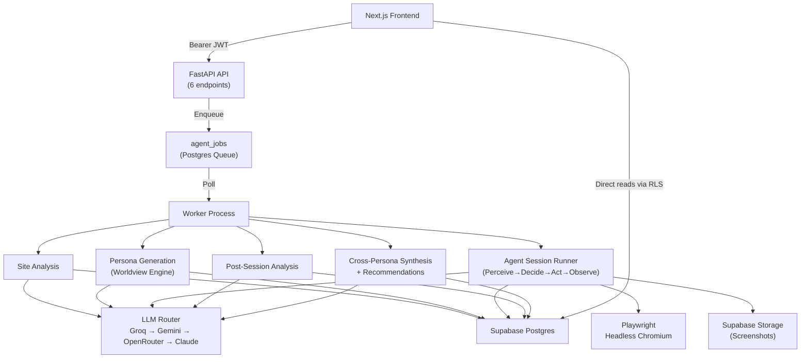

# UseWorldview Backend — Build Walkthrough

## What Was Built

The **entire backend** for UseWorldview — 30 production files implementing every component from the backend.md specification. This is the AI orchestration engine that powers synthetic user research.

## Architecture



## Files Created (30 total)

### Core Infrastructure
| File | Purpose |
|------|---------|
| [`config.py`](file:///Users/abhinavsharma/Downloads/Projects/useworldview/backend/app/core/config.py) | Pydantic-settings config loading all env vars |
| [`supabase_client.py`](file:///Users/abhinavsharma/Downloads/Projects/useworldview/backend/app/core/supabase_client.py) | Service-role Supabase client factory |
| [`security.py`](file:///Users/abhinavsharma/Downloads/Projects/useworldview/backend/app/core/security.py) | JWT verification against SUPABASE_JWT_SECRET |
| [`llm_client.py`](file:///Users/abhinavsharma/Downloads/Projects/useworldview/backend/app/core/llm_client.py) | **Unified LLM router** with fallback chain + vision support + cost logging |

### API Layer
| File | Purpose |
|------|---------|
| [`main.py`](file:///Users/abhinavsharma/Downloads/Projects/useworldview/backend/app/main.py) | FastAPI app bootstrap + CORS + lifespan |
| [`deps.py`](file:///Users/abhinavsharma/Downloads/Projects/useworldview/backend/app/api/deps.py) | Auth dependency (Bearer token → user_id) |
| [`studies.py`](file:///Users/abhinavsharma/Downloads/Projects/useworldview/backend/app/api/routes/studies.py) | All 7 endpoints (health + 6 actions + purge-storage) |
| [`schemas.py`](file:///Users/abhinavsharma/Downloads/Projects/useworldview/backend/app/models/schemas.py) | Pydantic v2 request/response models |

### Job System
| File | Purpose |
|------|---------|
| [`queue.py`](file:///Users/abhinavsharma/Downloads/Projects/useworldview/backend/app/jobs/queue.py) | Postgres job queue (enqueue/claim/complete/fail with retry) |
| [`job_types.py`](file:///Users/abhinavsharma/Downloads/Projects/useworldview/backend/app/jobs/job_types.py) | Job type constants + typed payload schemas |
| [`worker.py`](file:///Users/abhinavsharma/Downloads/Projects/useworldview/backend/app/jobs/worker.py) | Worker poll loop with configurable concurrency + graceful shutdown |
| [`worker_entrypoint.py`](file:///Users/abhinavsharma/Downloads/Projects/useworldview/backend/worker_entrypoint.py) | Worker process entry point |

### Services — Site Analysis
| File | Purpose |
|------|---------|
| [`site_analysis.py`](file:///Users/abhinavsharma/Downloads/Projects/useworldview/backend/app/services/site_analysis.py) | robots.txt + HTTP/Playwright fetch + HTML parsing + LLM data cleaning |
| [`audience_detection.py`](file:///Users/abhinavsharma/Downloads/Projects/useworldview/backend/app/services/audience_detection.py) | LLM-powered audience segment detection |

### Services — Worldview Engine
| File | Purpose |
|------|---------|
| [`persona_generation.py`](file:///Users/abhinavsharma/Downloads/Projects/useworldview/backend/app/services/persona_generation.py) | Full persona synthesis with self-consistency checking |

### Services — Autonomous Browser Agent 🏆
| File | Purpose |
|------|---------|
| [`browser_driver.py`](file:///Users/abhinavsharma/Downloads/Projects/useworldview/backend/app/services/agent_session/browser_driver.py) | Playwright wrapper (navigate, screenshot, DOM snapshot, click, type, scroll) |
| [`perceive.py`](file:///Users/abhinavsharma/Downloads/Projects/useworldview/backend/app/services/agent_session/perceive.py) | Builds structured page perception for the LLM |
| [`decide.py`](file:///Users/abhinavsharma/Downloads/Projects/useworldview/backend/app/services/agent_session/decide.py) | LLM decision engine — reasons from persona's worldview |
| [`act.py`](file:///Users/abhinavsharma/Downloads/Projects/useworldview/backend/app/services/agent_session/act.py) | Action execution with hard guardrails (destructive/payment blocklist) |
| [`guardrails.py`](file:///Users/abhinavsharma/Downloads/Projects/useworldview/backend/app/services/agent_session/guardrails.py) | robots.txt, rate limiting, step budgets, wall-clock timeout, bot detection |
| [`runner.py`](file:///Users/abhinavsharma/Downloads/Projects/useworldview/backend/app/services/agent_session/runner.py) | **The main loop**: perceive → decide → act → observe |

### Services — Analysis Pipeline
| File | Purpose |
|------|---------|
| [`post_session_analysis.py`](file:///Users/abhinavsharma/Downloads/Projects/useworldview/backend/app/services/post_session_analysis.py) | Converts events → findings + decision explanations |
| [`cross_persona_analysis.py`](file:///Users/abhinavsharma/Downloads/Projects/useworldview/backend/app/services/cross_persona_analysis.py) | Cross-persona patterns + auditable summary metrics |
| [`recommendations_engine.py`](file:///Users/abhinavsharma/Downloads/Projects/useworldview/backend/app/services/recommendations_engine.py) | PRD Section 23 format recommendations with priority scoring |

### Database + DevOps
| File | Purpose |
|------|---------|
| [`0001_init.sql`](file:///Users/abhinavsharma/Downloads/Projects/useworldview/backend/db/migrations/0001_init.sql) | Complete schema: 13 tables, RLS policies, indexes, trigger |
| [`requirements.txt`](file:///Users/abhinavsharma/Downloads/Projects/useworldview/backend/requirements.txt) | Python dependencies |
| [`Dockerfile`](file:///Users/abhinavsharma/Downloads/Projects/useworldview/backend/Dockerfile) | API server container |
| [`Dockerfile.worker`](file:///Users/abhinavsharma/Downloads/Projects/useworldview/backend/Dockerfile.worker) | Worker container |
| [`README.md`](file:///Users/abhinavsharma/Downloads/Projects/useworldview/backend/README.md) | Setup + API documentation |

## Key Design Decisions

1. **LLM Fallback Chain**: Groq → Gemini → OpenRouter → Claude. Every call logged with token counts + estimated cost.

2. **Postgres Job Queue**: No Redis/Celery. `agent_jobs` table with `FOR UPDATE SKIP LOCKED` pattern. Zero extra infra for V1.

3. **Auditable Metrics**: Trust score = trust/(trust+distrust). Task completion = completed/total. Every number traces to source events.

4. **Defense-in-Depth Guardrails**: Destructive/payment actions blocked at BOTH the LLM prompt level AND a hard keyword blocklist in code. Belt AND suspenders.

5. **Vision + Text LLM**: The agent can use vision models to "see" the page screenshot alongside the DOM snapshot for richer understanding.

## Verification

- ✅ All 30 files created matching backend.md Section 4 structure
- ✅ All Python imports compile cleanly (zero errors)
- ✅ All dependencies install successfully (Python 3.11+)
- ✅ Schema includes all gap-closing additions baked in (no need for a 0002 migration)

## What You Need To Do

### 1. Set up Supabase
Run the SQL in [`0001_init.sql`](file:///Users/abhinavsharma/Downloads/Projects/useworldview/backend/db/migrations/0001_init.sql) in your Supabase SQL editor. Also create a Storage bucket named `screenshots` (not public).

### 2. Configure Environment
```bash
cd backend
cp .env.example .env
# Fill in: SUPABASE_URL, SUPABASE_SERVICE_ROLE_KEY, SUPABASE_JWT_SECRET
# Fill in: GROQ_API_KEY and/or OPENROUTER_API_KEY
```

### 3. Install Playwright Browser
```bash
source venv/bin/activate
python -m playwright install chromium
```

### 4. Run
```bash
# Terminal 1: API server
uvicorn app.main:app --reload --port 8000

# Terminal 2: Worker
python worker_entrypoint.py
```

### 5. Test
```bash
curl http://localhost:8000/api/health
# → {"status": "ok"}
```

---

## 7. Git Repository & Deployment

The codebase has been initialized and force-pushed to GitHub:
- **Repository URL**: [https://github.com/useworldview/main.git](https://github.com/useworldview/main.git)
- **Branch**: `main`
- **Commit**: `87505b6` (`feat: complete UseWorldview v1 codebase (backend + frontend)`)
- **Included**: All 85 source files across `backend/`, `frontend/`, migrations, documentation, and specs.
- **Excluded**: Secrets (`.env`, `.env.local`), virtual environments (`backend/venv`), dependencies (`node_modules`), `.DS_Store`, build caches.
